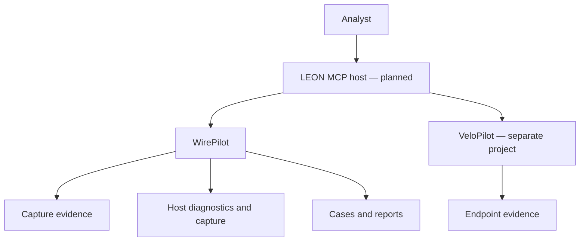

# WirePilot within Project LEON

LEON is the planned host/orchestrator. WirePilot owns network evidence; VeloPilot
owns endpoint/Velociraptor evidence. Each server exposes stable, independently
testable MCP tools. Do not create a separate MCP server for each network command.

The WirePilot server in this package is implemented. LEON orchestration and a
WirePilot-to-VeloPilot handoff transport are not implemented here.

## Investigation contract

Each packet analysis returns a capture ID, SHA-256, scope/limits, unsupported fields
and findings. Findings include rule identifiers, observed packet references, times,
severity, qualitative confidence, interpretation, plausible alternatives and next steps.
Confidence labels are investigator guidance, not calibrated probabilities.

A host should first establish the symptom, affected assets, time window and evidence
vantage point. It should test the strongest hypothesis, seek contradictory evidence,
then propose the least disruptive next action. No remediation tool exists in 1.0.0rc1.

## Connection failure example

1. Is the capture at the affected client and within the failure window?
2. Did DNS return an error? A missing response requires wider timing/packet context.
3. Is there neighbour/route/ICMP evidence? Local state applies only to the MCP host.
4. Are SYN, SYN-ACK and resets visible? Check capture asymmetry before blaming a firewall.
5. Is a receiver zero window or retransmission pattern present?
6. Is TLS failing, or did the application return an error despite TCP success?
7. Which device logs, listener state or endpoint evidence will separate the remaining causes?

## Ransomware example

WirePilot identifies visible network leads: file-operation activity, admin-service
fan-out, suspicious regular connections or supplied IOCs. LEON should correlate
asset identity and timestamps with VeloPilot's process trees, EDR alerts, file changes,
remote service/task creation and authentication records. Time zones, clock skew,
NAT and DHCP reuse must be resolved before associating an IP with a host.

The output of this version is a handoff recommendation, not an executed endpoint
collection. Actual VeloPilot tools and permissions must be discovered by LEON.

## Future adapter contract

Device/flow/log adapters should produce timestamped observations with source IDs,
collection method, raw-evidence references, parser version and visibility gaps. Keep
vendor credentials outside tool parameters and model context. Begin with fixed
read-only operations and fixture-based adapter tests. Add change operations only
after implementing an explicit change plan, authorisation, rollback and verification.

For remote deployment, add authenticated transport and tenant/evidence isolation
before exposing any network service. Stdio is the only transport shipped here.
